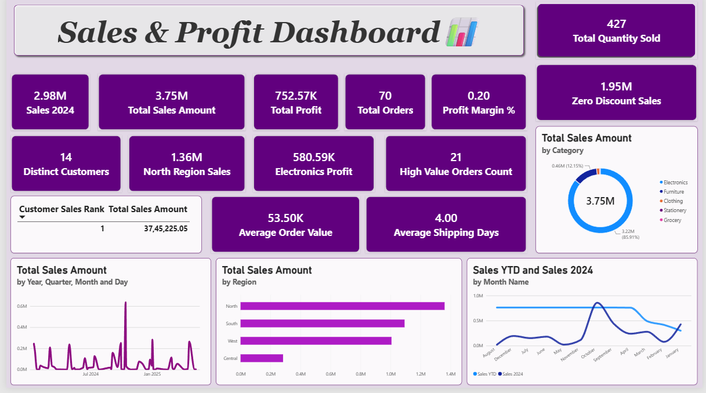

# 📊 Sales & Profit Dashboard | Power BI

## 📌 Project Overview
The Sales & Profit Dashboard is an interactive business intelligence project developed using Microsoft Power BI. It provides insights into sales performance, profitability, customer behavior, regional sales, product categories, and sales trends.

The dashboard uses DAX calculations, calculated columns, and Power Query transformations to support data-driven business analysis.

## 🎯 Project Objectives
- Analyze overall sales and profit performance.
- Monitor key business performance indicators (KPIs).
- Compare sales across regions and product categories.
- Analyze customer sales performance and rankings.
- Track sales trends and year-to-date performance.
- Evaluate order volume, quantity sold, and shipping duration.

## 📈 Key Performance Indicators (KPIs)

| KPI | Value |
|---|---:|
| Total Sales Amount | 3.75M |
| Sales 2024 | 2.98M |
| Total Profit | 752.57K |
| Total Orders | 70 |
| Total Quantity Sold | 427 |
| Distinct Customers | 14 |
| Average Order Value | 53.50K |
| Average Shipping Days | 4.00 |
| High Value Orders Count | 21 |
| North Region Sales | 1.36M |
| Electronics Profit | 580.59K |
| Zero Discount Sales | 1.95M |

## 🔍 Dashboard Features
- **Sales Analysis:** Analyze sales performance and trends over time.
- **Profitability Analysis:** Monitor total profit and category-level profit.
- **Regional Analysis:** Compare sales across North, South, West, and Central regions.
- **Category Analysis:** Explore sales across different product categories.
- **Customer Analysis:** Rank customers based on sales performance.
- **Time-Based Analysis:** Compare year-to-date sales with the 2024 sales measure.
- **Order Analysis:** Track order counts, quantity sold, and high-value orders.

## 🛠️ Tools & Technical Skills
- **Microsoft Power BI:** Dashboard development and data visualization.
- **DAX Measures:** KPI calculations and business metrics.
- **Calculated Columns:** Custom row-level calculations.
- **Power Query Advanced Editor:** Writing M code for data transformation.
- **Data Modeling:** Organizing data and supporting analytical calculations.
- **Interactive Visualizations:** Presenting business metrics through charts and KPI cards.

## 🖼️ Dashboard Preview

## 💡 Key Insights
- Total sales amount is displayed as 3.75M.
- Total profit is displayed as 752.57K.
- The North region contributes 1.36M in sales.
- Electronics contributes 580.59K in profit.
- Zero-discount sales account for 1.95M.

These observations are based on the values displayed in the dashboard.

## 📁 Project Files
- `Sales-and-Profit-Dashboard.pbix` — Power BI report file.
- `Sales-Profit-Dashboard.png` — Dashboard preview image.

## ⚠️ Disclaimer
This project was created for learning and portfolio purposes. Confidential or sensitive data should not be shared publicly.
